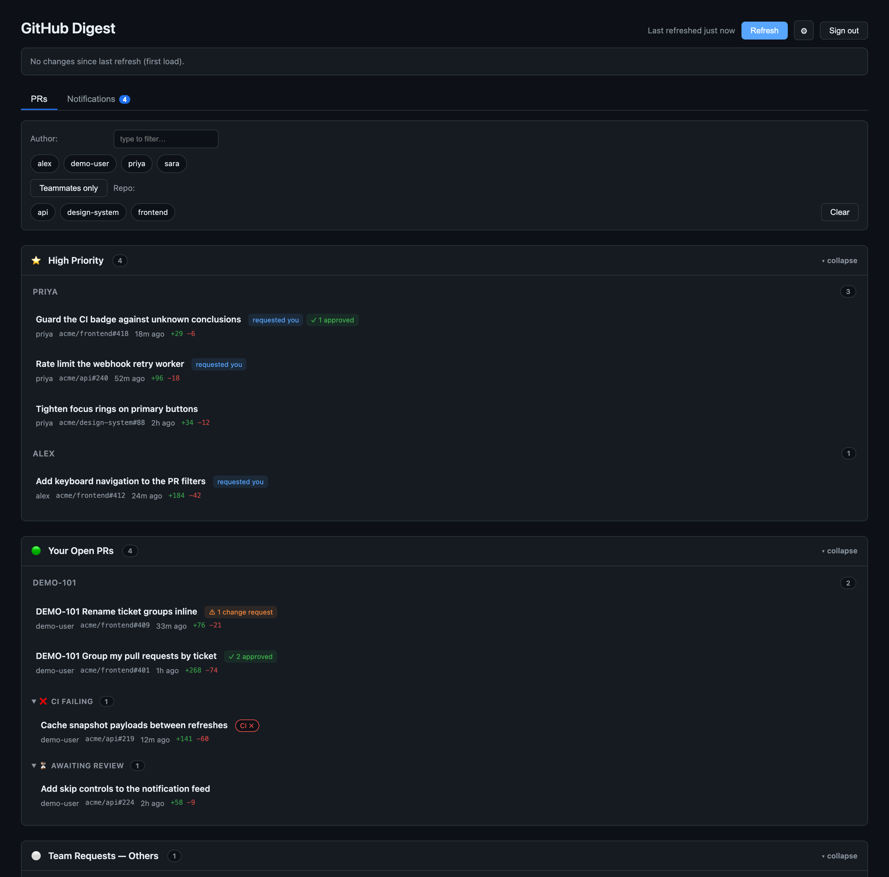
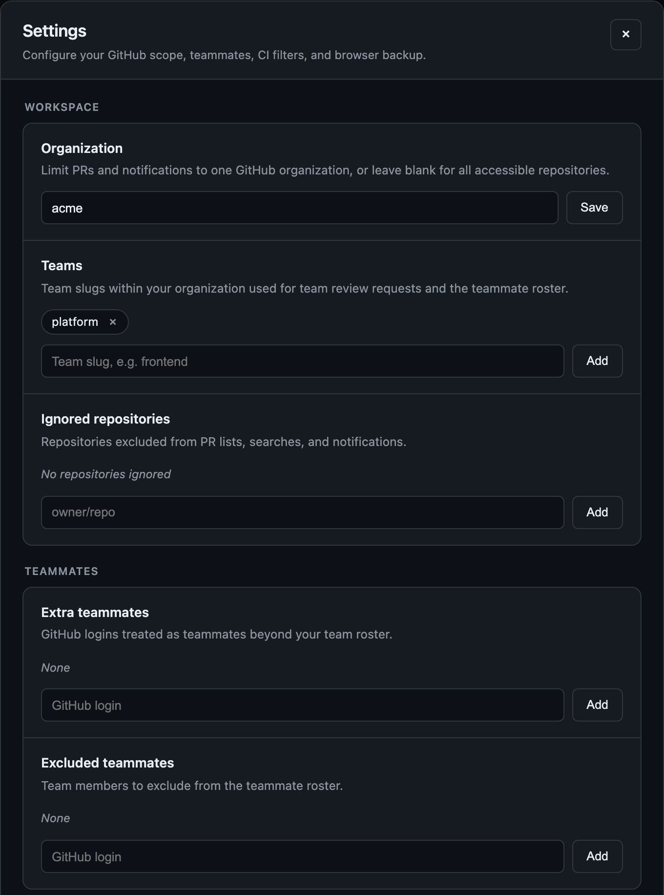
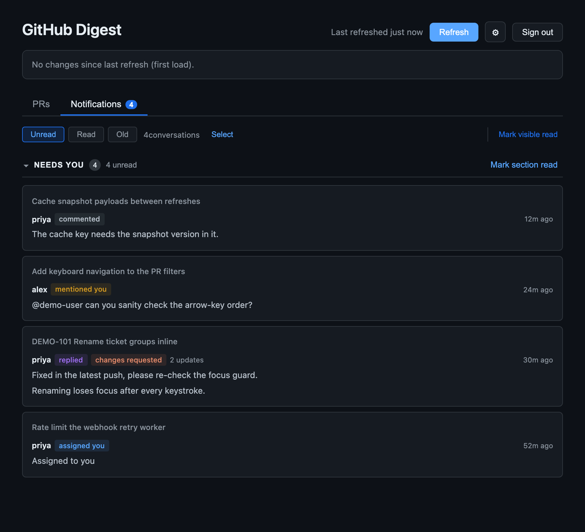

# GitHub View

A local GitHub PR triage dashboard built with Preact. Review requests, your open PRs, team activity, notes, and notification triage stay in one fast, read-only place.

## Why it exists

GitHub's default pull requests and notifications pages mix everything together: direct review requests, team-wide pings, PRs someone else already approved, flaky CI checks, and stale threads.

GitHub View organizes your open PRs and recent activity into clear sections so you can see what actually needs your attention:

- **High Priority** groups direct review requests and teammate PRs that still need a review, with drafts tucked away and manual pins at the top.
- **Your Open PRs** splits your PRs by status (CI failing, changes requested, approved, awaiting review), groups multi-PR tickets together, and lets you set PRs aside.
- **Team Handled & Engaged** moves PRs you or a teammate already covered out of the way, while surfacing them again if new commits or review activity arrive.
- **Notifications** groups recent comments, mentions, reviews, and assignments by PR thread with read/pin/bulk controls and local history.

## See it in action

**PR dashboard and Settings.**

<table>
  <tr>
    <td width="56%" valign="top">
      <a href="docs/demo/pr-dashboard.png"></a>
    </td>
    <td width="44%" valign="top">
      <a href="docs/demo/settings.png"></a>
    </td>
  </tr>
</table>

Click either image for the full-size capture. High Priority collects direct and team review requests, Your Open PRs groups by ticket and CI state, and Settings configures the workspace without touching code.

**Notifications triage.**



## Quick start

Requires Node 22.12+ and npm.

1. Clone the repo:

   ```sh
   git clone https://github.com/Oluwa-nifemi/github-view.git
   cd github-view
   ```

2. Install dependencies, build, and start the local server:

   ```sh
   npm ci
   npm run build
   npm start
   ```

3. Open [http://127.0.0.1:4173](http://127.0.0.1:4173). Paste your GitHub Personal Access Token, optionally enter your organization and team slugs, and click **Save and load**.

Leave Organization and Teams blank to include pull requests from all accessible repositories. You can change your workspace scope and preferences at any time from **Settings**.

### Run with Docker

Docker is the shortest cross-platform path: no Node install, no login service, works on macOS, Linux, and Windows.

```sh
git clone https://github.com/Oluwa-nifemi/github-view.git
docker compose up -d --build
```

Open [http://127.0.0.1:4173](http://127.0.0.1:4173) and paste your token. The container comes back after a reboot (`restart: unless-stopped`) and keeps your data, because all state lives in your browser. Update it later with `git pull && docker compose up -d --build`, stop it with `docker compose down`.

Without Compose:

```sh
docker build -t github-view .
docker run --rm -p 127.0.0.1:4173:4173 github-view
```

The image builds the app and serves it with no runtime dependencies, because `scripts/serve.mjs` uses only Node built-ins. Both commands publish the port on `127.0.0.1` only, so the dashboard is not reachable from your network. Set `PORT` and `HOST` to listen elsewhere — the same variables work for `npm start`.

### Run automatically on macOS

To keep the server running in the background whenever you log in:

```sh
npm run startup:install
```

The installer installs dependencies, builds the app, and registers a macOS LaunchAgent. No Docker or terminal window is needed afterward. It starts the local server only — not browser windows or desktop notifications. See [docs/startup.md](docs/startup.md) for status and removal commands.

### What to connect

**GitHub token.** Create a Personal Access Token at [github.com/settings/tokens/new](https://github.com/settings/tokens/new) with:

- `repo` — read pull requests, reviews, comments, and CI checks
- `read:org` — read team memberships when teams are configured
- `notifications` — read recent pull request notifications

If your organization enforces SAML SSO, authorize the token for SSO on GitHub after generating it.

## Features

- **Actionable PR sections:** High Priority, Your Open PRs, Team Requests — Others, Team Handled, Engaged, Teammates' Open PRs, Archived, and Deleted
- **Smart review & CI classification:** Separates failing CI, requested changes, approvals, and awaiting review, with per-repo or global CI check ignore rules
- **Ticket grouping & local labels:** Automatically groups your PRs that share a ticket ID (e.g. `ABC-123`) and lets you rename groups locally without changing PR or tracker titles
- **Personal triage state:** Pin PRs to High Priority, set your own PRs aside, add private notes, archive until new activity arrives, or hide permanently
- **Notification feed:** Groups reviews, comments, mentions, and assignments by PR thread with unread, pinned, and history filters
- **Fast startup:** Primary PRs appear before notification enrichment finishes on first load; complete snapshots are cached locally and refreshed automatically in the background
- **Portable settings:** Export and import notes, filters, and preferences as JSON (tokens are always excluded)
- **Optional macOS watcher:** `.gh-digest/watch.mjs` is a separate one-shot desktop-notification script using your existing `gh` CLI login

## Settings

Click the gear icon (**⚙**) in the header to configure everything from the UI:

- **Workspace:** Filter by a single GitHub organization (or leave blank for all accessible repos), add team slugs for team review requests and teammate rosters, and ignore specific repositories (`owner/repo`).
- **Teammates:** Add extra GitHub logins beyond your team roster or exclude specific members.
- **Automation & CI:** Optionally set an AI/agent bot login so its PRs assigned to you appear under Your Open PRs, and add case-insensitive CI check ignore rules.
- **Data & Backup:** Export or import browser settings, notes, and (optionally) cached PRs and notification history.

## Development

```sh
npm run dev
```

Vite prints the development URL and reloads changes automatically. Keep using the same hostname and port (`127.0.0.1:4173` vs `localhost`) to retain browser storage.

```sh
npm test
npx playwright install chromium
npm run test:e2e
npm run test:live
```

Unit tests cover domain rules, API behavior, snapshot stages, and the optional watcher. Browser tests exercise synthetic PRs through the real UI and snapshot builder. The live test reads `gh auth token` into an isolated browser, uses no credential files or tracing, and destroys the browser afterward.

See [github-digest.map.md](github-digest.map.md) for module ownership and data contracts, and [docs/audit.md](docs/audit.md) for architecture notes. Shipped JavaScript is roughly 25 KB gzipped.

## Privacy and limits

- **Read-only:** The dashboard never posts reviews, comments, or merges pull requests.
- **Local only:** The server listens on `127.0.0.1` only. Your GitHub token stays in your browser's `localStorage` and is only sent directly to `api.github.com`.
- **Credential-free exports:** Settings exports never include your GitHub token.
- **Search limits:** GitHub search caps results at 1,000 items per query. If you work across very large organizations, scope the dashboard to your organization and teams in Settings.

## License

MIT. See [LICENSE](LICENSE).
